# 요즘 바이브코딩

**내가 원하는 작업을, 내 방식으로**

수도여자고등학교 1·2학년 · 김형훈 · 2026년 10월 개정

## 한 페이지 요약

“늘 하던 방식 말고, 다른 방법은 없을까?” 익숙한 일을 다시 보면 해 보고 싶은 작업이 생겨요. 성적표를 점수 확인에서 다음 공부를 정하는 자료로 바라보는 것처럼요. **관점에서 질문으로, 질문에서 작은 시도로, 결과에서 다시 배움으로** 이어지는 강의입니다.

코드를 처음부터 쓰는 일이 낯설어도 하고 싶은 일을 말이나 글로 설명해 AI 코딩 도구로 코드 초안을 만들고 실행해 볼 수 있어요. 학과 자료를 비교하는 표나 성적 변화 그래프, 탐구 파일 정리도 할 수 있습니다. 앱은 여러 결과물 중 하나예요.

요청문 한 번으로 일이 끝나지는 않아요. 무엇을 왜 할지 정하고 자료와 조건을 고른 뒤 결과가 맞는지 확인하는 일은 내 몫입니다.

이때 **도메인 지식**, 즉 그 분야를 이해하는 지식이 필요해요. 점수와 등급의 차이를 알아야 성적 그래프를 제대로 읽을 수 있듯이요. 공부하며 배운 내용은 내 생각을 구체적으로 설명하고 결과를 판단할 때 쓸 수 있습니다.

> 아는 만큼 말할 수 있고, 말하는 만큼 만들 수 있습니다.

이 책 앞부분은 50분씩 세 차시로 진행하는 강의를 미리 읽고 복습하는 내용이에요. 뒤에는 혼자 따라 할 수 있는 가이드가 있어요. 수업에서는 설치나 긴 실습 대신 사례를 보고 조건을 고른 뒤 강사 시연에서 오류를 찾아봅니다.

## 책을 읽는 방법

컴퓨터에서는 **책 보기**로 두 쪽을 펼쳐 볼 수 있어요. 휴대폰에서는 글씨를 편하게 읽는 **읽기 모드**로 시작합니다. 글자 크기를 바꾸거나 책 보기로 전환할 수도 있어요.

- 책 보기: 좌우로 스와이프하거나 화살표로 쪽을 넘겨요.
- 읽기 모드: 아래로 스크롤해요. 좌우 스와이프로는 한 화면씩 이동해요.
- 목차·검색·책갈피로 필요한 곳을 다시 찾아요.
- 요청문의 **복사**를 누르면 해당 요청문 전체가 복사돼요.
- 목차 아래에서 PDF와 원고를 내려받을 수 있어요.

그림은 실제 강의 슬라이드에 쓰인 삽화예요. 대학의 추천 결과나 AI 도구의 실제 실행 화면을 뜻하지는 않아요. 가상 점수 그래프는 본문의 표를 직접 그린 설명용 예시입니다.

## STAGE 01 · 관점을 바꿔 필요한 일 찾기


### 먼저, 밸런스 게임

**A. 코드는 낯설지만 해 보고 싶은 일이 있다.**

**B. 코딩은 잘하지만 해 보고 싶은 일이 아직 없다.**

둘 중 하나만 고른다면요? 이유도 한 문장으로 생각해 보세요. C도 있지만 마지막에 공개합니다. 지금 화면을 오래 봐도 아직 안 나와요.

급식 별점 앱을 떠올릴 수도 있어요. 다만 제육파와 돈가스파의 평화까지 보장할 수는 없겠죠. 오늘은 여러분의 진로와 공부에 도움이 될 만한 작업을 살펴볼게요.

### 추천도서에서 꺼낸 첫 질문

박용후의 **『관점을 디자인하라』**는 익숙한 일을 다른 시선으로 살펴보게 하는 책이에요. 관점은 무엇에 주목하며 보는지라고 생각해 보세요. 급식 줄이 길 때 “어떻게 더 빨리 줄을 설까?”를 물을 수도 있고 “왜 같은 시간에 몰릴까?”를 물을 수도 있죠. 같은 장면에서도 질문에 따라 해 볼 일이 달라집니다.

남들과 무조건 달라야 한다는 뜻은 아니에요. 내가 익숙해서 놓친 필요를 찾아보자는 거예요.

### 익숙한 서비스에서 발견하는 질문

| 서비스 | 우리가 다시 던져 볼 질문 |
|---|---|
| 카카오톡 | 연락을 더 편하게 주고받으려면? |
| 아이폰 | 전화·음악·인터넷 기능을 한 기기에서 쓴다면? |
| 배달의민족 | 메뉴 비교부터 주문까지 한곳에서 할 수 있다면? |

위 질문은 실제 창업자 발언이 아니라 강의에서 재구성한 질문이에요. 카카오와 배달의민족은 [출판사의 도서 소개](https://samnparkers.com/book/book_detail.do?bkcd=2505220004)에 나오는 사례이고 아이폰은 강의용 비교 사례입니다. 전화·음악·인터넷 기능의 결합은 [Apple의 아이폰 발표](https://www.apple.com/newsroom/2007/01/09Apple-Reinvents-the-Phone-with-iPhone/)에서도 확인할 수 있어요.

어떤 기술 이름을 붙였는지보다 사람들이 하던 일이 어떻게 달라졌는지 살펴보세요. 우리도 가까운 곳에서 작게 시작할 수 있습니다.

### 내 일상의 불편을 질문으로

| 익숙한 생각 | 바꿔 볼 질문 | 먼저 해 볼 작업 |
|---|---|---|
| 무슨 과가 좋을까? | 재미있었던 활동을 어느 수업에서 더 배울까? | 관심 활동과 공식 교육과정 비교표 |
| 이번 시험 망했다 | 다음 공부는 무엇부터 하면 좋을까? | 점수 변화 그래프와 오답 유형 목록 |
| 최종 파일이 또 늘었다 | 필요할 때 바로 찾으려면? | 파일 이름 변경 전후 미리보기 |
| 수행평가 마감이 헷갈린다 | 오늘 먼저 할 일을 한눈에 볼 수 있을까? | 마감일과 남은 일을 정리한 표 |

20초만 생각해 보세요. 내가 겪은 불편 하나를 “어떻게 하면?”으로 시작하는 질문으로 바꿔 보세요. 큰 발명이나 거창한 앱부터 떠올릴 필요는 없어요. 강의에서는 설치 대신 질문 하나를 고르고 시연에서 그 질문을 어떻게 작업으로 옮기는지 봅니다.

### 바이브코딩으로 무엇을 하나요?

코드는 컴퓨터에서 실행할 명령을 적은 글이에요. 표를 읽고 숫자를 계산하고 그래프를 그리는 순서를 코드로 적을 수 있어요. 파일 이름을 바꾸거나 웹페이지를 만드는 데도 쓰고요.

이 강의에서 다루는 바이브코딩은 **원하는 작업을 자연어로 설명해 AI 코딩 도구로 코드 초안을 만드는 데서 시작해요. 코드를 실행한 뒤 결과를 보며 수정하는 과정까지 포함해요.** 채팅으로 의견을 묻는 것만으로 모든 과정이 끝나지는 않습니다.


코드 파일이 생겼다고 작업이 잘 끝났다는 뜻은 아니에요. 수학 점수 72를 넣었는데 27로 표시됐다면 고쳐야 하죠. 무엇을 바꾸고 무엇은 그대로 둘지 정하는 사람은 나예요.

## 사례 1 · 나와 맞는 학과 후보 비교하기


“나한테 맞는 과가 뭘까?”에서 “내가 재미있었던 활동을 어느 수업에서 더 배울까?”로 질문을 바꿔 볼게요. 바로 하나를 고르기는 어렵죠. 먼저 재미있게 했던 활동을 적어 보세요. 환경 문제를 조사하고 설문 응답을 정리하는 일이 즐거웠다고 가정해 볼게요.

관련 학과의 공식 교육과정을 모아 같은 기준으로 표를 만들면 비교하기 편해요. 코드로 자료를 읽어 표를 만드는 작업입니다.

| 내가 알고 싶은 것 | 확인할 자료 | 다음 질문 |
|---|---|---|
| 무슨 수업을 들을까? | 대학 학과의 공식 교육과정 | 실험·토론·자료 분석 중 어떤 활동이 있을까? |
| 내 관심과 어떻게 이어질까? | 관심 활동 기록과 교과목 설명 | 재미있었던 활동을 더 깊이 해 볼 수 있을까? |
| 무엇을 더 준비할까? | 학과 안내와 지원 연도 공식 자료 | 지금 공부에서 더 살펴볼 내용은 무엇일까? |

이 표는 특정 학과를 추천한 결과가 아니라 **비교 기준의 예시**예요. 실제 표를 만들 때는 원문과 링크를 대조해야 해요. 없는 수업을 채워 넣거나 학과 이름만 보고 적합도를 단정하지 않도록요.

결과는 내가 후보를 살펴보고 선생님과 상담할 때 쓸 자료예요. 진로를 대신 결정해 주는 답은 아니죠. 관심이 바뀌면 비교 기준도 다시 바꿔 보세요.

## 사례 2 · 내 성적을 분석해 다음 공부 정하기


성적표를 보고 “망했다”로 끝낸 적 있나요? 조금 더 구체적으로 볼 수 있어요. 과목별 변화와 자주 틀리는 유형을 살펴 다음 주에 할 공부를 정하는 거예요.

수업에서는 실제 학생 성적 대신 **100점 만점의 가상 원점수**를 사용합니다.

| 과목 | 시험 1 | 시험 2 | 시험 3 | 처음과 마지막 차이 |
|---|---:|---:|---:|---:|
| 수학 | 72 | 78 | 81 | +9점 |
| 영어 | 86 | 82 | 84 | −2점 |


계산은 확인할 수 있어요. 81−72는 9, 84−86은 −2입니다. 하지만 이것만으로 실력이 정확히 얼마나 변했다고 말하기는 어려워요. 시험 난도와 범위가 다를 수 있으니까요.

틀린 문제도 함께 봐야 다음 계획을 세울 수 있어요. 조건을 빠뜨린 문제가 반복됐다면 풀이 전에 조건에 표시하는 연습을 해 볼 수 있겠죠. **그래프를 그린 다음 무엇을 공부할지는 내가 판단합니다.**

원점수와 등급은 의미가 다르고 빈칸과 0점도 달라요. 자료를 이해해야 요청할 조건과 확인 기준을 정할 수 있습니다.

## 사례 3 · 탐구 파일 정리하기

탐구 폴더에 이런 파일이 있나요?

> 최종.pdf / 진짜최종.pdf / 진짜최종2.pdf

최종 파일이 다섯 개면 최종 회의부터 해야겠네요. 파일 이름을 날짜·과목·주제처럼 일정한 규칙으로 바꾸거나 자료 목록을 만들 때도 코드를 쓸 수 있어요. 앱 화면이 꼭 필요한 건 아닙니다.

| 기존 이름 | 바꿀 이름의 예시 |
|---|---|
| 컵설문초안.txt | 2026-10-01_사회_컵설문_초안.txt |
| 응답정리.csv | 2026-10-03_사회_컵설문_응답.csv |

위 날짜와 과목은 연습용이에요. 실제로는 파일마다 확인한 정보를 써야 합니다. 모르는 날짜를 임의로 채우지 마세요.

먼저 **바뀔 이름을 표로만 확인**하고 복사본 몇 개로 시험해 보세요. 같은 이름이 이미 있으면 덮어쓰지 않고 멈추게 해야 해요. 좋은 조건은 “깔끔하게”보다 “원본 보존, 중복 확인, 적용 전 미리보기”에 가까워요.

## 활동 설명도, 내가 한 일을 아는 데서

강의에서는 선생님이 가상 활동의 면접자가 됩니다. 여러분은 빠진 설명을 찾아보세요.

**가상 활동 기록**

일회용 컵을 줄이는 방안을 탐구했어요. 설문 질문을 만들고 응답을 정리했어요. 컵을 씻는 곳과 들고 다닐 때의 불편을 개선하자고 제안했어요. 응답한 학생들의 생각이 전교생의 생각과 같다고 단정할 수는 없어요.

첫 답변이 “열심히 했고 협력의 중요성을 배웠습니다”라면 무엇이 궁금한가요? 맡은 일과 조사 방법이 빠져 있죠. 실제 기록을 바탕으로 설명을 보탤 수 있어요.

> 설문 질문을 만들고 응답을 정리했습니다. 컵을 씻는 곳과 들고 다닐 때의 불편을 살펴 개선 방안을 제안했습니다. 다만 응답자 범위에 한계가 있어 전교생의 생각이라고 말할 수는 없습니다.

“전교생을 조사했고 컵 사용을 30% 줄였다”는 말은 기록에 없어요. 이 문장은 오류를 찾기 위한 예시입니다. 성과가 혼자 자라나면 안 되겠죠.

반복해서 연습하고 싶다면 질문·메모·타이머를 모은 작은 앱도 만들 수 있어요. 앱 제작은 여러 활용 중 하나예요. 뒤에 선택 가이드를 실었습니다.


## STAGE 02 · 질문을 설명과 확인 기준으로


첫 시간에 바꾼 질문을 작업으로 옮겨 볼까요? “다음 공부는 무엇부터 할까?”라는 질문에도 점수 변화와 오답처럼 살펴볼 자료가 여러 가지예요. 먼저 지금 자료로 확인할 수 있는 범위를 정합니다.

“성적 좀 분석해 줘.” 이 말에는 빠진 조건이 많아요. 원점수인가요, 등급인가요? 점수 변화를 볼 건가요, 오답 유형을 모을 건가요?

요청문을 **프롬프트**라고 해요. 마법의 문장을 외우기보다 다음 네 칸을 채워 보세요.

| 항목 | 성적 그래프 예시 |
|---|---|
| 목표 | 과목별 점수 변화를 보고 싶다 |
| 자료 | 2과목, 시험 3회의 가상 원점수 CSV |
| 결과 | 그래프와 원자료 표가 있는 보고서 |
| 확인 기준 | 값·시험 순서·축이 맞고 빈칸을 0점으로 채우지 않는다 |

앱 개발에서는 제품이 해야 할 일을 정리한 문서를 **PRD**라고 해요. 지금은 네 칸 정도로 작게 시작해도 됩니다. 꼭 필요한 것부터 만든 첫 버전을 **MVP**라고 부르기도 해요.

처음부터 자동 수집, 로그인, 앱 화면을 전부 넣을 필요는 없어요. 마라탕도 첫 주문에 토핑을 다 담으면 감당이 안 됩니다. 그래프 하나를 확인한 다음 필요한 일을 넓혀 가세요.

### 모르는 조건을 찾는 요청

```text
가상 점수표로 과목별 변화를 보고 싶어.
요청에 빠진 조건을 확인할 수 있도록 하나씩 질문해 줘.
원점수인지 등급인지, 시험 순서, 빈칸 처리, 결과 형식을 먼저 확인해 줘.
답을 임의로 정하지 말고 내가 고른 조건을 정리해 줘.
```

생성된 질문은 빠진 조건을 찾는 데 참고하세요. 어떤 조건을 받아들일지는 내 목적과 자료를 보고 정합니다.

## 예쁘게 나왔는데 틀렸다면?

그래프에서 빈칸을 0점으로 채우면 없었던 급락이 생길 수 있어요. 표에 있던 과목명이 바뀌거나 시험 순서가 뒤집힐 수도 있고요. 보기 좋은 결과인지, 맞는 결과인지는 따로 확인해야 합니다.

| 작업 | 먼저 확인할 것 |
|---|---|
| 학과 비교 | 공식 자료에 있는 수업인가? 출처를 열 수 있나? |
| 성적 그래프 | 원자료의 값·축·시험 순서·빈칸 처리가 맞나? |
| 파일 정리 | 원본이 남아 있나? 이름이 겹치나? 미리보기를 확인했나? |
| 활동 설명 | 실제로 한 일인가? 없는 성과가 추가됐나? |

오류를 발견하면 무엇을 했고 무엇을 기대했고 실제로 무엇이 나왔는지 적어 보세요.

```text
영어의 시험 2 점수를 비워 둔 예제로 실행했어.
빈칸은 자료 없음으로 표시되길 기대했는데 그래프에 0점이 찍혔어.
빈칸을 숫자로 바꾸지 않도록 수정해 줘.
원래 예제의 수학 72·78·81과 영어 86·82·84는 그대로인지 확인해 줘.
```

고친 뒤에는 원래 잘되던 부분도 다시 확인하세요. “안 돼요”보다 구체적인 증상이 수정할 곳을 찾는 데 도움이 됩니다.

## 자료와 기능의 범위를 정하기

오늘은 가상 점수와 가상 활동, 연습용 파일 목록을 써요. 실제 성적표나 학생부 전체를 넣지 않아도 과정을 익힐 수 있어요. 이름을 지워도 다른 정보로 누구인지 알아볼 수 있습니다.

자료를 넣기 전에 세 가지를 생각해 보세요. 작업에 꼭 필요한가요? 누구에게 전달되나요? 어디에 남고 누가 볼 수 있나요?

복사는 내 기기에 붙여 넣을 내용을 담는 단계예요. 외부 서비스에 붙여 넣어 전송하면 그 내용이 전달돼요. 복사 버튼만 눌렀다고 AI 기능이 실행되는 것은 아니에요.

### 앱으로 넓힐 때 알아둘 말

| 말 | 뜻 | 확인할 점 |
|---|---|---|
| 프런트엔드 | 화면과 버튼처럼 사용자가 접하는 부분 | 화면이 있다고 기능까지 연결된 것은 아니에요 |
| 서버·백엔드 | 요청을 받아 처리하는 컴퓨터와 처리 부분 | 자료를 어디에서 다루는지 확인해요 |
| 데이터베이스(DB) | 자료를 구조에 맞춰 보관하는 곳 | 누가 읽고 고칠 수 있는지 정해요 |
| 인증 | 누구인지 확인하는 일 | 로그인 여부를 확인해요 |
| 권한 | 무엇을 할 수 있는지 정하는 일 | 다른 사람의 기록에 접근할 수 없는지 확인해요 |
| API | 프로그램끼리 요청을 주고받는 통로 | 연결 대상과 전달할 자료를 확인해요 |

모든 작업에 이 기능이 필요한 건 아니에요. 가상 성적 그래프 한 장에는 로그인이나 API 키가 없어도 돼요. 여러 사람이 기록을 저장하는 앱으로 넓히려면 별도로 설계하고 확인해야 해요.

API 키는 일부 서비스를 이용할 때 제시하는 비밀 문자열이에요. 공개되면 다른 사람이 사용해 비용이 생길 수 있어요. 설정에서 환경변수에 따로 적어도 브라우저로 전달되면 숨겨지지 않아요. 비밀 키가 필요한 연결은 서버에서 관리해야 해요.

## 저장하고 나누기

결과가 잘 나오는지 확인했다면 원자료와 코드를 함께 저장하세요. 바꾼 내용을 한 줄로 남겨 두면 다시 실행할 때 도움이 돼요.

**Git**은 파일의 변경 이력을 관리하는 도구예요. **GitHub**에는 저장소를 온라인으로 둘 수 있어요. 그래프 코드와 파일 정리 코드도 관리할 수 있습니다. 실제 학생 기록이나 비밀 키는 공개 저장소에 넣지 마세요.


표나 그림은 파일로 나눠도 돼요. 웹페이지를 여러 사람이 열게 하려면 웹사이트로 배포할 수 있어요. **배포**는 다른 사람이 접근할 수 있는 곳에 올리는 일이에요. 링크만 있다고 개인 기록 저장이나 AI 연결 기능까지 갖춰지는 건 아니에요.

## STAGE 03 · 시도하고 배우고 다시 보기

“다음 공부를 정하려면 무엇을 봐야 할까?”라는 질문을 작은 작업으로 시험해 봅니다. 선생님은 시연에서 가상 점수표를 읽어 그래프와 표가 담긴 `report.html`을 만들어요. 브라우저에서 보는 보고서예요. 여러분의 실제 성적을 모으는 서비스는 아니에요.

1. 가상 CSV의 숫자를 확인해요.
2. 목표·자료·결과·확인 기준을 요청문에 적어요.
3. 생성한 코드를 실행한 뒤 결과 파일을 열어요.
4. 숫자·축·빈칸 처리를 원자료와 대조해요.
5. 고칠 부분 하나를 골라 수정하고 다시 확인해요.

수학은 72→78→81, 영어는 86→82→84예요. 처음과 마지막 점수의 차이를 직접 계산해 표시된 값과 비교하세요. 그다음 빈칸 예제도 확인해요.

고칠 부분은 여러분이 골라요. **A. 과목명 글씨를 크게 / B. 점 옆에 숫자 표시.** 주문은 딱 하나만 받습니다. 수정한 뒤에도 점수와 계산은 같아야 해요.

시연 중 오류가 나면 증상을 읽고 수정할 조건을 찾아요. 실행이 오래 걸리거나 접속이 안 되면 준비된 예제로 같은 검사를 이어 가요. 어떤 결과를 쓰든 확인 기준은 원자료예요.

## 처음의 질문으로 돌아가 보기

처음 소개한 『관점을 디자인하라』를 떠올려 보세요. 우리는 같은 성적표를 점수 확인에서 다음 공부를 정하는 자료로, 학과 안내를 이름 목록에서 배우는 내용을 비교하는 자료로 바꿔 봤어요.

그런데 **다르게 보기만 하면 충분할까요?** 점수가 올랐다는 그래프를 확인했어도 시험 난도와 오답을 모르면 다음 공부를 정하기 어려워요. 학과 이름만 알면 어떤 수업을 비교해야 할지도 막연하고요.

아는 것이 늘면 살펴볼 조건과 질문도 늘어나요. 통계의 기초를 배우면 설문에 누가 답했는지 묻게 되고 학과의 교육과정을 알면 내 관심과 어떻게 이어지는지 더 구체적으로 비교할 수 있어요. 관점과 도메인 지식을 잇는 이 설명은 **책의 직접 인용이 아니라 강의의 해석**입니다.

처음 고른 불편을 다시 떠올리며 네 가지를 적어 보세요.

- 처음에는 무엇이 당연하다고 생각했나요?
- 관점을 바꾸니 어떤 질문이 생겼나요?
- 작은 작업으로 무엇을 확인했고 무엇은 아직 모르나요?
- 더 잘 판단하려면 무엇을 배워야 하나요?

관점 → 질문 → 작은 시도 → 결과 확인 → 배움 → 다시 질문하기. 새로운 질문은 다음 작업의 시작이 될 수 있어요.

## C 공개 · 그래서 공부하세요

처음의 A와 B를 기억하나요? 이제 C를 공개해요.

> C. 아는 것을 바탕으로 필요한 작업을 설명하고 결과를 확인하는 사람.

좋은 질문을 더 깊게 만들고 결과를 판단할 때, 그 분야를 이해하는 지식인 **도메인 지식**이 필요해요. 성적을 해석하려면 점수의 의미를, 설문을 읽으려면 응답자의 범위를 알아야 하죠. 모든 것을 배운 뒤에야 시작할 수 있다는 뜻은 아니에요. 해 보다가 모르는 것을 찾아 공부하고 다시 질문하면 돼요.


| 학교에서 배우는 것 | 작업에 쓰이는 순간 |
|---|---|
| 국어 | 원하는 조건과 내가 한 일을 구체적으로 설명할 때 |
| 수학 | 수치·그래프·표본을 읽고 계산을 확인할 때 |
| 과학·사회 | 조사 방법과 근거, 해석의 한계를 살필 때 |
| 영어 | 더 많은 자료와 설명을 읽을 때 |

**아는 만큼 말할 수 있고, 말하는 만큼 만들 수 있습니다.**

만들기는 앱만 뜻하지 않아요. 비교표나 그래프를 만들고 내가 하던 작업 방식을 바꾸는 것도 포함해요. 설명과 판단에 쓸 재료는 공부와 경험에서 쌓여요.

그래서 결론은… 공부하세요. 바이브코딩 강의를 들었는데 숙제가 늘어난 기분이죠?

MISSION COMPLETE. 다음 스테이지는 내일 1교시입니다.

## 강의 허브 · 먼저 결과를 열어 보세요

이 책에 나오는 예제는 [강의 허브](https://hoonikims.github.io/vibe-book/)에서 직접 열 수 있어요. 성적 숫자를 바꾸고, 학과 비교표에 내 생각을 적고, 파일 이름이 겹치는지 검사해 보세요. 예제를 보는 데는 계정이나 프로그램 설치가 필요하지 않습니다.

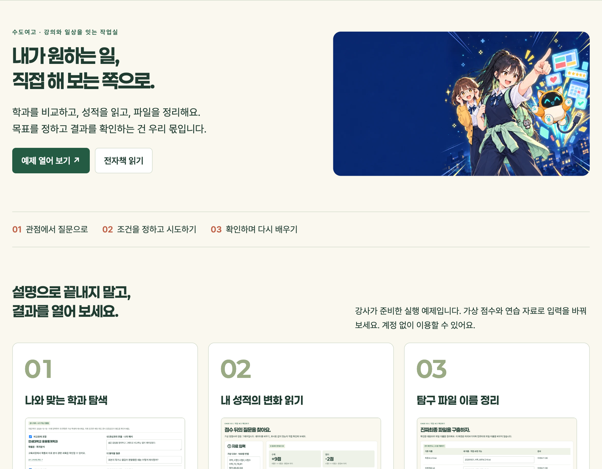

휴대폰에서는 사례를 살펴보고 요청문을 복사할 수 있어요. 코드를 직접 만들고 파일을 다루는 따라하기는 PC에서 진행하는 편이 좋습니다. 강의 중 모든 과정을 끝내려고 서두를 필요는 없어요. 먼저 무엇을 확인할지 생각해 보세요.

### 화면을 읽는 세 가지 표시

| 표시 | 뜻 |
|---|---|
| 실제 실행 화면 | 이 허브에서 작동하는 예제를 직접 열어 캡처했어요 |
| 개발창 형태의 요청 예시 | 프롬프트를 읽기 쉽게 재구성했어요. 실제 서비스의 실행 기록은 아니에요 |
| 가상 자료 | 수업을 위해 만든 점수나 활동 기록이에요 |

책의 화면을 누르면 원본 이미지를 크게 볼 수 있어요. 프롬프트는 이미지 아래의 글로도 제공해요. **전체 복사** 버튼을 누른 뒤, 내 작업에 맞게 조건을 확인하고 입력하세요. PDF에서는 버튼 대신 허브 링크를 이용하면 됩니다.

## 사용할 도구 · 브라우저와 Codex

이번 가이드에서는 **Codex로 연습 폴더의 파일을 만들고, 브라우저에서 결과를 확인하는 경로**를 설명해요. 어떤 기능을 쓸지 정하고 파일 변경과 실행 내용을 확인하는 사람은 나예요.

| 도구 | 맡길 작업 | 내가 확인할 것 |
|---|---|---|
| Codex | 요청에 맞는 코드 작성·수정·실행 | 작업 폴더, 변경할 파일, 실행한 검사 |
| Chrome·Edge·Safari 등 브라우저 | HTML 결과 열기 | 숫자·문구·버튼 동작 |
| 탐색기·Finder | 자료와 결과 파일 찾기 | 실제 파일명과 확장자 |
| 스프레드시트 프로그램 | CSV 비교표 읽기 | 열이 제대로 나뉘었는지, 원자료와 같은지 |

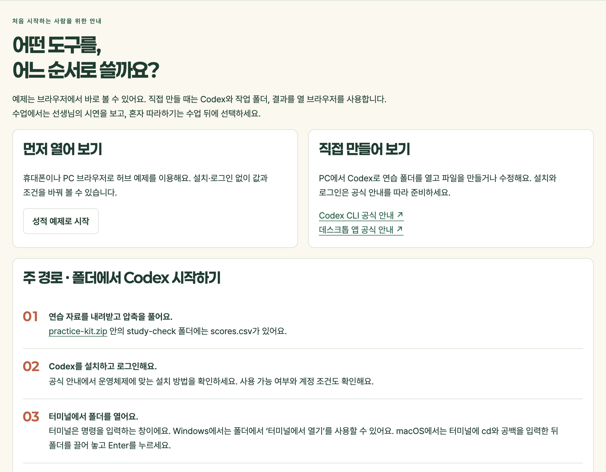

Codex의 설치·로그인 방법은 [공식 CLI 안내](https://learn.chatgpt.com/docs/cli)를 확인하세요. 데스크톱 앱을 이용한다면 [공식 앱 안내](https://learn.chatgpt.com/docs/app)를 참고하세요. 서비스 화면과 이용 조건은 바뀔 수 있어요. 학교에서 허용하는 환경인지도 확인해요.

이 안내는 2026년 10월 19일의 공식 자료와 로컬 Codex CLI 0.163.0 도움말을 확인해 작성했습니다. 아래 요청문은 특정 모델 이름을 전제로 하지 않아요.

## 시작 화면 1 · 자료가 있는 폴더부터

[연습 자료 ZIP](https://hoonikims.github.io/vibe-book/downloads/practice-kit.zip)을 내려받아 압축을 풀어요. 폴더 안에는 성적 분석 자료와 파일 정리용 복사본, 요청문 텍스트가 들어 있습니다.

| 폴더·파일 | 쓰임 |
|---|---|
| study-check/scores.csv | 기본 가상 점수표 |
| study-check/scores-gap.csv | 빈칸 처리 확인용 자료 |
| study-check/report.html | 강사가 준비한 결과 예시 |
| file-practice/mapping.csv | 파일 이름 대응표 |
| file-practice/rename_files.py | 미리보기·이름 변경 실행 코드 |
| prompts/ | 복사해 쓸 요청문 텍스트 |

**작업 폴더**는 이번에 사용할 자료와 결과를 모아 두는 곳이에요. 바탕화면 전체를 작업 대상으로 삼을 필요는 없어요. 성적 그래프를 만들 때는 `study-check` 폴더만 열면 됩니다.

시작하기 전에 `scores.csv`를 열어 보세요. 수학은 72, 78, 81이고 영어는 86, 82, 84예요. 결과 화면을 보기 전에 답을 한 번 계산해 두면 확인하기 쉬워요. 수학은 +9점, 영어는 −2점입니다.

폴더에 들어 있는 `report.html`은 강사가 준비한 예시예요. 직접 생성해 보는 연습을 시작하기 전에 이 파일의 이름을 `report-example.html`로 바꿔 보관하세요. 그래야 새로 만든 결과와 구분할 수 있어요.

## 시작 화면 2 · Codex에 요청 입력하기

터미널은 명령을 입력하는 창이에요. Windows에서는 작업 폴더의 ‘터미널에서 열기’를 이용할 수 있어요. macOS에서는 터미널에 `cd`와 공백을 입력한 뒤 폴더를 끌어 놓고 Enter를 누르면 그 폴더로 이동할 수 있어요.

Codex 설치를 마쳤다면 해당 폴더에서 다음 명령을 입력해요.

```bash
codex
```

첫 실행에서는 안내에 따라 로그인해요. 표시된 폴더가 내가 준비한 `study-check`인지 확인한 다음 성적 그래프 요청문을 입력하세요. 설치나 계정 준비가 어렵다면 허브의 실행 예제로 먼저 확인하는 연습을 해도 됩니다.

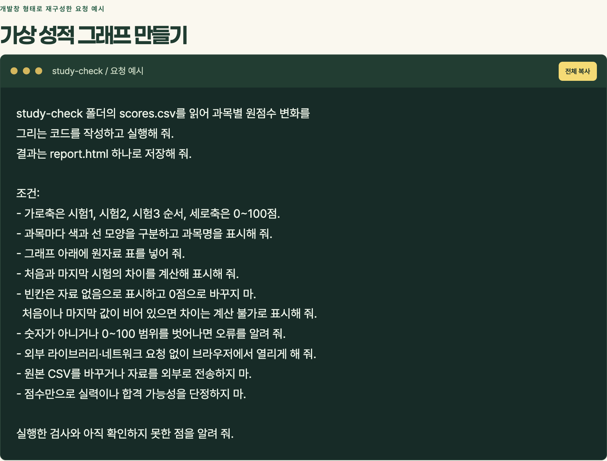

개발창을 이용하는 목적은 멋진 명령어를 외우는 데 있지 않아요. 내 자료로 무엇을 하고 싶은지 구체적으로 설명하고, 생성한 파일과 실제 결과를 확인하는 데 있어요. 전체 요청문은 뒤의 ‘따라하기 B’에서 복사할 수 있습니다.

## 시작 화면 3 · 코드와 결과를 구분하기

요청 뒤에 코드가 나타났다고 작업이 끝난 것은 아니에요. 다음 세 가지를 구분해 보세요.

1. **작성:** 어떤 파일이 만들어졌나요?
2. **실행:** 그 파일이나 코드를 실제로 실행했나요?
3. **확인:** 나온 결과를 원자료와 대조했나요?

예를 들어 `report.html`이라는 파일이 생겼다면 탐색기나 Finder에서 찾아 브라우저로 열어요. 코드 문자만 보이면 파일 확장자를 확인하세요. `report.html.txt`로 저장됐을 수도 있어요.

폴더 접근이나 명령 실행 확인이 나타나면 작업 대상과 내용을 읽고 진행하세요. 요청한 작업과 상관없는 폴더 변경이나 파일 삭제가 필요하지는 않습니다. 모르는 명령이라면 무엇을 하는지 먼저 설명을 요청하세요.

웹 채팅에서 코드만 받았다면 파일 저장과 실행 단계가 따로 필요할 수 있어요. 사용하는 제품이 결과 파일을 제공하는지 확인하세요. 실행하지 못했다는 안내가 나오면, 그 상태를 성공으로 받아들이지 말고 준비된 예제로 확인 절차를 먼저 익혀 보세요.

## 화면으로 따라가기 A · 학과를 비교하는 기준

“나와 맞는 과를 골라 줘”라고만 요청하면 무엇을 근거로 고를지 불분명해요. 먼저 내가 좋아했던 활동과 비교할 자료를 정해 보세요.

> 설문 응답을 정리하고 차이를 그래프로 보는 일이 재미있었다. 이 관심과 이어지는 수업을 찾아보고 싶다.

허브의 [학과 탐색 예제](https://hoonikims.github.io/vibe-book/major.html)에는 세 학과의 공식 교육과정 정보와 가상 학생의 관심을 나란히 놓았습니다. 예제로 선택한 학과이며 추천 순위나 지원 권고가 아닙니다.

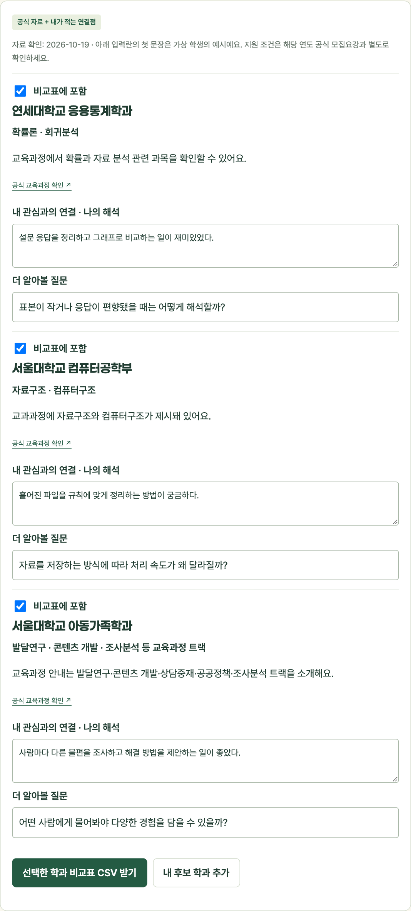

왼쪽의 교육과정 링크를 열어 수업이나 트랙 이름을 확인하세요. 오른쪽에는 그 내용이 내 관심과 어떻게 연결되는지 적어요. 관심과 연결된다는 설명은 자료에 적힌 사실과 구별한 **나의 해석**입니다.

### 결과를 직접 바꾸는 순서

1. 비교할 학과의 체크 표시를 골라요.
2. 관심과의 연결점과 더 알아볼 질문을 내 말로 고쳐요.
3. ‘내 후보 학과 추가’에서 다른 대학·학과의 자료를 넣을 수 있어요.
4. 출처 주소와 확인한 날짜까지 입력해요.
5. ‘선택한 학과 비교표 CSV 받기’를 눌러 파일로 보관해요.

새로고침하면 입력한 내용은 사라져요. 남겨 두고 싶은 비교표는 먼저 내려받으세요. 입시 조건은 지원 연도의 공식 모집요강에서 따로 확인하고 선생님과 상담할 자료로 활용하세요.

## 학과 탐색 · 요청과 판단을 나란히

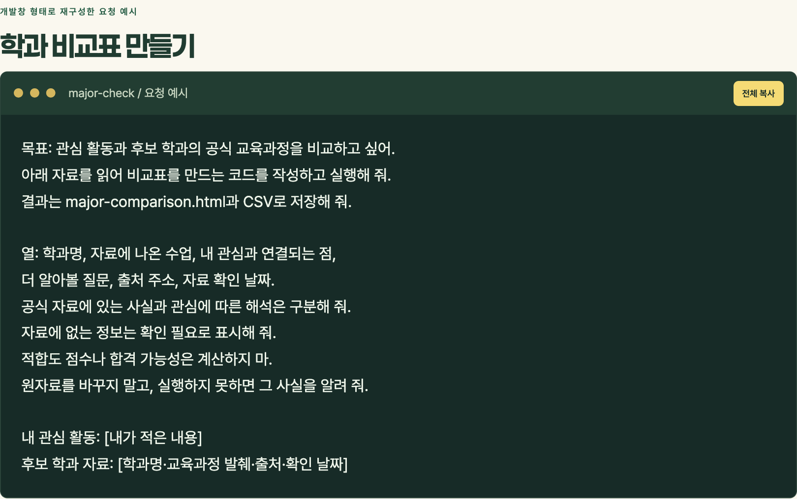

처음 요청을 다음처럼 바꾸면 필요한 자료가 분명해져요.

| 첫 요청 | 조건을 보완한 요청 |
|---|---|
| 나에게 맞는 과 알려 줘 | 내가 적은 관심 활동과 후보 학과의 공식 교육과정을 비교해 줘 |
| 좋은 순서대로 추천해 줘 | 자료에 있는 수업과 내 해석을 구별하고 더 알아볼 질문을 남겨 줘 |
| 표로 만들어 줘 | 출처 주소와 확인 날짜가 있는 HTML·CSV 비교표로 저장해 줘 |

표가 깔끔해졌다고 학과를 정할 근거까지 충분해지는 것은 아니에요. 어떤 수업을 배우는지, 그 분야의 어떤 활동이 궁금한지 더 알아봐야 해요. 필요한 지식을 조금씩 배우면서 비교 기준도 고칠 수 있습니다.

아래 세 출처에서 예제의 교육과정 내용을 확인할 수 있어요. 확인일은 2026년 10월 19일입니다.

- [연세대학교 응용통계학과 교육과정](https://economics.yonsei.ac.kr/stat/education/process.do)
- [서울대학교 컴퓨터공학부 교과과정](https://cse.snu.ac.kr/ko/academics/undergraduate/courses)
- [서울대학교 아동가족학과 교과과정](https://childfamily.snu.ac.kr/under_curriculum/)

## 화면으로 따라가기 B · 성적을 읽는 첫 화면

[성적 분석 예제](https://hoonikims.github.io/vibe-book/scores.html)를 열면 왼쪽에 가상 CSV, 오른쪽에 그래프와 원자료 표가 보여요. 휴대폰에서는 입력과 결과가 위아래로 놓입니다.

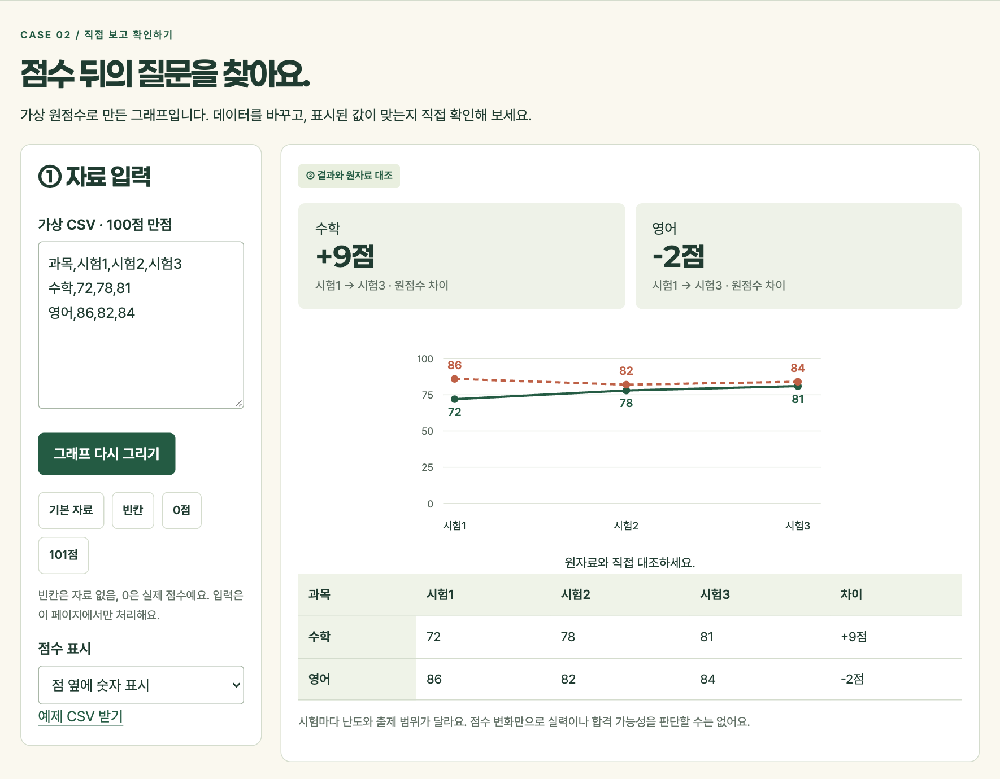

‘기본 자료’를 누르면 수학 72→78→81, 영어 86→82→84로 돌아가요. 숫자를 바꾼 뒤에는 ‘그래프 다시 그리기’를 누르세요. 입력을 고치는 동안에는 이전 결과를 숨겨 새 자료의 결과로 오해하지 않게 했습니다.

‘점수 표시’에서 숫자를 표시하거나 선과 점만 볼 수 있어요. 표시 방식이 달라져도 원점수와 차이는 같아야 합니다. 이처럼 **화면 수정 뒤에도 계산이 그대로인지 확인**하는 습관이 필요해요.

현재 결과는 HTML 보고서로, 현재 자료는 CSV로 내려받을 수 있어요. HTML 파일은 브라우저로 다시 열어 확인할 수 있습니다. 예제는 입력한 자료를 서버에 보내지 않아요. 다만 별도 AI 도구에 요청문이나 자료를 입력하는 행위는 그 서비스의 처리 대상이 될 수 있으니 가상 자료로 연습하세요.

## 성적 분석 · 빈칸과 0점은 다르다

‘빈칸’ 버튼을 눌러 영어 시험2를 확인해 보세요. 표에는 ‘자료 없음’이 표시되고 그래프의 선은 그 구간에서 끊겨요.

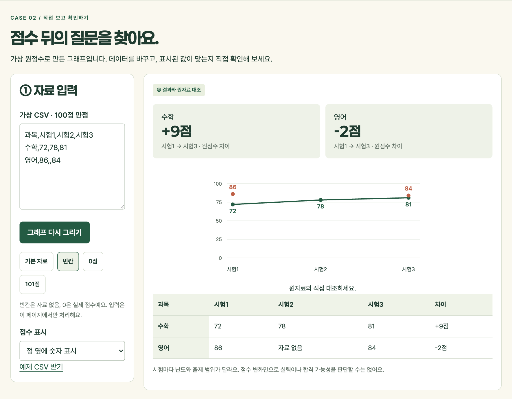

이번에는 ‘0점’을 눌러 보세요. 0은 실제 값이므로 점을 표시해야 해요. 빈칸과 같은 방식으로 숨기면 잘못된 결과입니다.

| 확인할 입력 | 기대하는 결과 |
|---|---|
| 영어 시험2가 빈칸 | 자료 없음 표시, 해당 구간의 선 끊김 |
| 영어 시험2가 0 | 0점으로 표시 |
| 첫 시험 또는 마지막 시험이 빈칸 | 처음과 마지막의 차이는 계산 불가 |
| 점수가 101 | 범위를 벗어났다는 오류 안내 |

처음이나 마지막 값을 비우는 검사는 CSV에서 직접 지운 뒤 ‘그래프 다시 그리기’를 누르면 돼요. 허브는 자료가 없는 값을 임의로 추측해 채우지 않습니다.

## 성적 분석 · 틀릴 수 있는 곳부터 확인

‘101점’ 버튼을 누르면 오류 안내가 나오고 그래프는 숨겨져요. 오류가 있는데도 이전 결과를 그대로 보여 주면 새 자료를 분석한 것으로 착각할 수 있어요.

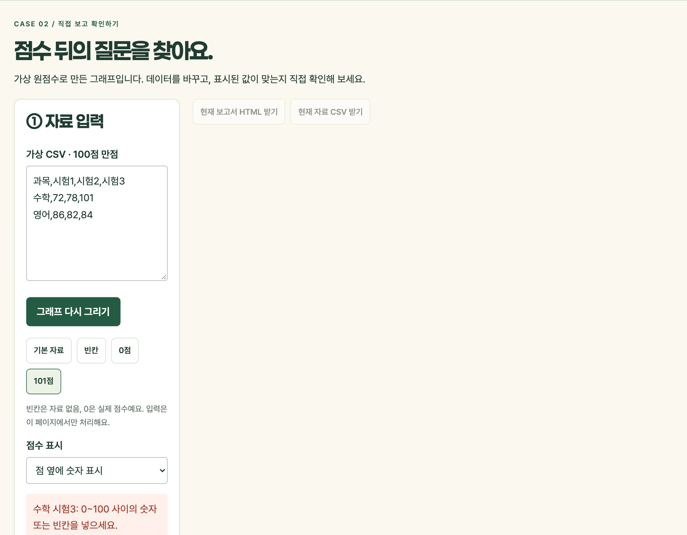

직접 만든 결과가 빈칸을 0으로 처리한다면 다음처럼 수정 조건을 구체적으로 설명할 수 있어요. 이 프롬프트는 **그런 오류가 있을 때 사용하는 예시**이며, 위 허브 화면에서 발생한 오류 기록은 아닙니다.

```text
현재 결과에서 영어 시험2의 빈칸이 0점으로 표시돼.
원자료에서 빈칸은 시험을 보지 않아 자료가 없다는 뜻이야.
빈칸은 자료 없음으로 표시하고 선을 끊어 줘.
0점은 실제 점수이므로 그대로 표시해 줘.
처음이나 마지막 값이 없으면 차이는 계산 불가로 표시해 줘.
숫자, 축의 범위, 과목별 색은 바꾸지 마.
빈칸·0점·101점 입력을 각각 검사하고 결과를 알려 줘.
```

수정 결과에서도 같은 입력을 다시 시험하세요. “수정했습니다”라는 문장과 실제 동작이 일치하는지 확인하는 과정입니다.

## 성적 분석 · 요청을 고치면 무엇이 달라질까

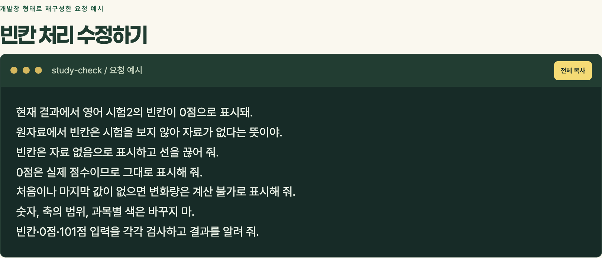

“성적 분석해 줘”만으로는 원점수를 볼지 등급을 볼지, 평균을 낼지 과목별 변화를 볼지 알기 어려워요. 이번 예제에서는 원점수, 세 번의 시험, 0~100의 축, 처음과 마지막의 차이를 기준으로 정했어요.

같은 숫자도 기준에 따라 다른 모습으로 보일 수 있어요. 세로축을 70부터 시작하면 작은 변화가 훨씬 커 보일 수 있죠. 그래프가 예뻐졌는지뿐 아니라 **무엇을 어떤 범위로 보여 주는지** 살펴야 해요.

그래프에서 수학 점수가 올랐다는 것은 확인할 수 있어요. 하지만 시험 난도와 출제 범위, 오답을 모르고 실력이 그만큼 늘었다고 단정할 수는 없어요. 여기서 필요한 지식이 수학과 통계, 그리고 내가 공부한 내용입니다.

## 성적 분석 · 다음 공부 한 가지 남기기

허브 결과 아래에는 ‘다음 공부는 내가 정하기’ 메모가 있어요. 점수에 대한 감상보다 오답에서 찾은 근거를 적어 보세요.

| 확인한 것 | 다음에 해 볼 공부 |
|---|---|
| 문제의 조건을 놓친 오답이 반복됐다 | 조건에 밑줄을 긋고 풀이 전에 다시 읽기 |
| 계산은 맞지만 개념 설명을 못 했다 | 개념을 한 문장으로 설명하고 예를 하나 들기 |
| 영어 지문에서 연결 관계를 놓쳤다 | 접속 표현과 지시 대상에 표시하며 읽기 |

위 내용은 공부 방법을 생각해 보기 위한 예시예요. 실제 계획은 내 오답과 선생님의 조언을 바탕으로 정하세요. 메모를 남기고 ‘내 계획 TXT 받기’를 누르면 파일로 보관할 수 있어요.

다음 시험에서 계획을 지켰는지, 같은 실수가 줄었는지 다시 살펴보세요. 한 번의 그래프가 결론을 대신하지는 않아요. 자료를 확인하고 다음 행동을 정하는 데 쓰는 것이지요.

## 화면으로 따라가기 C · 파일 이름 미리보기

[파일 정리 예제](https://hoonikims.github.io/vibe-book/files.html)는 기존 이름과 새 이름을 나란히 보여 줍니다. 화면에서 새 이름을 고친 뒤 ‘대응표 검사’를 눌러 보세요.

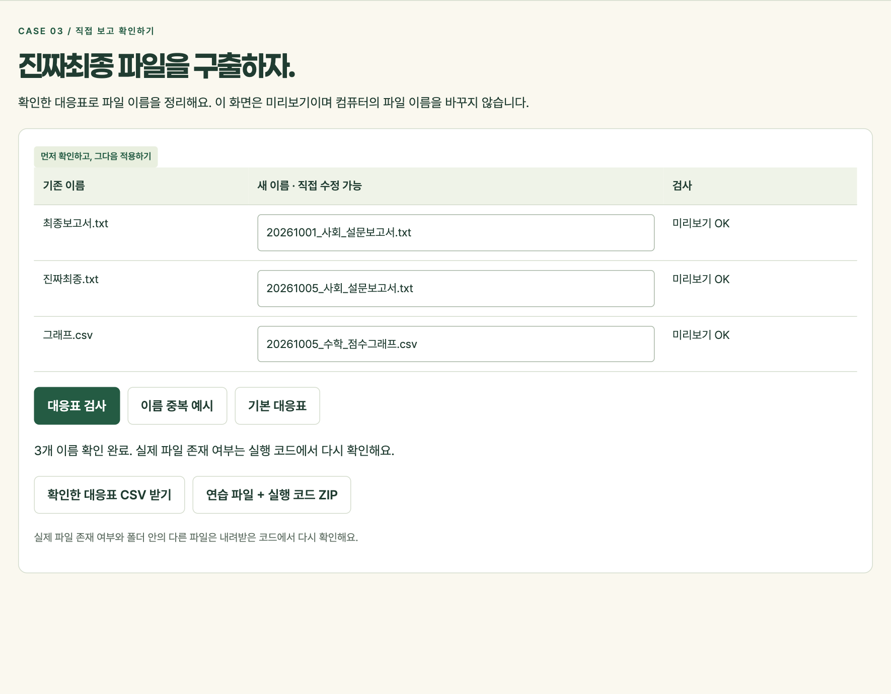

예제 이름의 날짜와 과목은 연습을 위해 정한 값이에요. 실제 자료를 정리할 때는 파일마다 확인한 값으로 바꿔야 해요. 이름만 보고 작성일이나 과목을 추측해 넣지 마세요.

파일 이름의 `.txt`, `.csv` 부분은 확장자예요. 이름을 보기 좋게 바꾸다가 확장자까지 바꾸면 어떤 프로그램으로 열어야 하는지 혼동할 수 있어요. 예제에서는 확장자가 바뀌면 확인하라는 안내를 보여 줍니다.

이 웹 화면에서는 실제 파일을 변경하지 않아요. 검사한 대응표를 CSV로 받고, 실제 존재 여부를 확인하는 코드는 PC의 연습 폴더에서 실행해요. **미리보기와 적용을 나누는 이유**를 생각해 보세요.

## 파일 정리 · 이름이 겹치면 멈추기

‘이름 중복 예시’를 누르면 두 파일의 새 이름이 같아져요. 이 상태에서는 대응표를 받을 수 없어요. 이름을 서로 다르게 고친 뒤 다시 검사하세요.

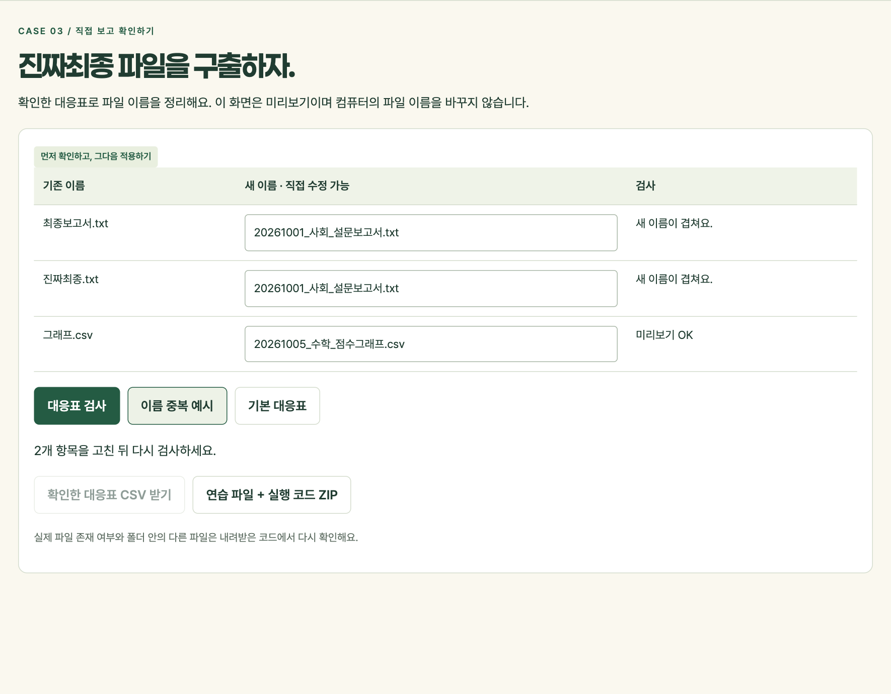

작은 자료에서는 하나씩 확인할 수 있지만 파일이 많아질수록 놓치기 쉬워요. 코드를 이용하면 같은 검사를 반복할 수 있습니다. 그렇더라도 **무엇을 중복으로 볼지, 어떤 규칙을 쓸지** 먼저 정해야 해요.

예제 코드는 실제 폴더에 같은 이름의 파일이 이미 있는지도 확인해요. 대응표에 없는 파일을 덮어쓰거나 삭제하지 않습니다. 허브 화면의 검사를 통과했다고 PC 폴더의 상태까지 확인된 것은 아니에요.

## 파일 정리 · 복사본으로 실행하기

[파일 정리 연습 ZIP](https://hoonikims.github.io/vibe-book/downloads/file-practice.zip)을 내려받아 압축을 풀어요. `file-practice` 안에는 세 개의 가상 파일, 대응표, 실행 코드가 있습니다.

Python이 설치된 PC에서 그 폴더를 열고 미리보기부터 실행하세요. 다음은 Windows에서 사용할 수 있는 명령 예시예요.

```bash
py rename_files.py
```

macOS에서는 보통 다음 명령을 사용해요.

```bash
python3 rename_files.py
```

화면에 기존 이름과 새 이름이 표시되지만 파일은 그대로여야 해요. 확인을 마친 뒤에만 적용 옵션을 붙입니다.

```bash
python3 rename_files.py --apply
```

Windows에서는 앞의 `python3`를 `py`로 바꿔요. 적용 후에는 파일 수와 내용을 확인하고 `rename-log.csv`의 변경 기록을 읽어 보세요. 이 예제는 연습용 복사본에서만 실행하세요.

## 파일 정리 · 결과는 앱 밖에도 남아요

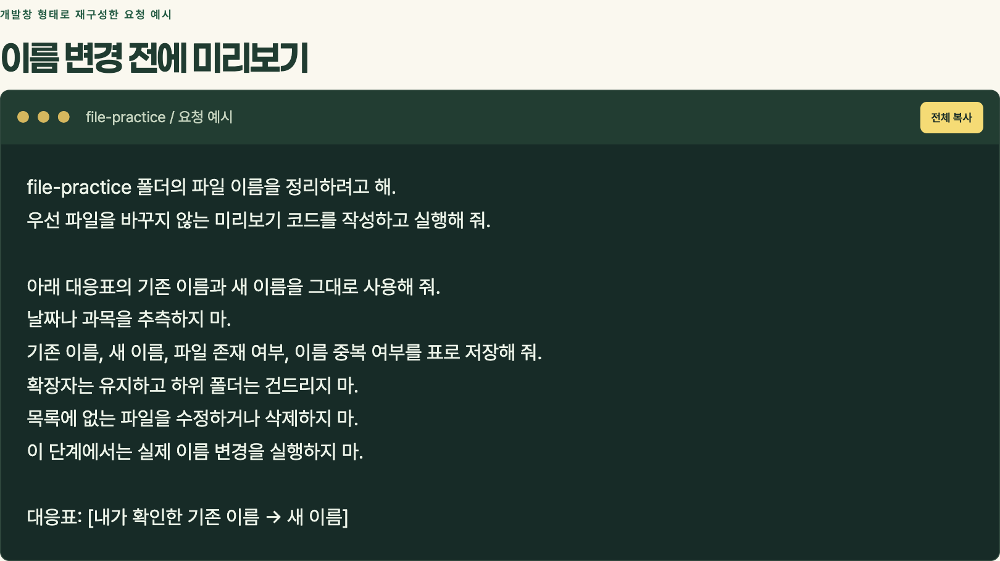

이 사례의 결과물은 화려한 앱 하나가 아니에요. 내가 정한 대응표, 반복해서 실행할 코드, 이름을 정리한 복사본과 변경 기록이 남습니다. 원하던 작업을 코드로 처리한 것이죠.

‘진짜최종’이 ‘진짜진짜최종’으로 진화하는 속도만큼 정리 규칙도 중요해요. 날짜·과목·주제 중 어떤 정보를 이름에 넣을지 먼저 생각해 보세요. 다음 달의 내가 찾을 수 있는 이름이면 좋겠습니다.

국어 시간에 배운 분류와 설명, 탐구에서 익힌 자료 정리 방법도 이런 작업에 쓰여요. 코드를 이용하기 전에 알아야 할 것이 무엇인지 찾는 과정에서 공부의 필요성이 다시 드러납니다.

## 선택 확장 화면 · 활동 설명 연습장

[면접 연습장](https://hoonikims.github.io/vibe-book/interview.html)에는 가상 활동 하나와 질문 다섯 개가 있어요. 실제 대학의 기출 문제나 합격 평가 서비스가 아닙니다.

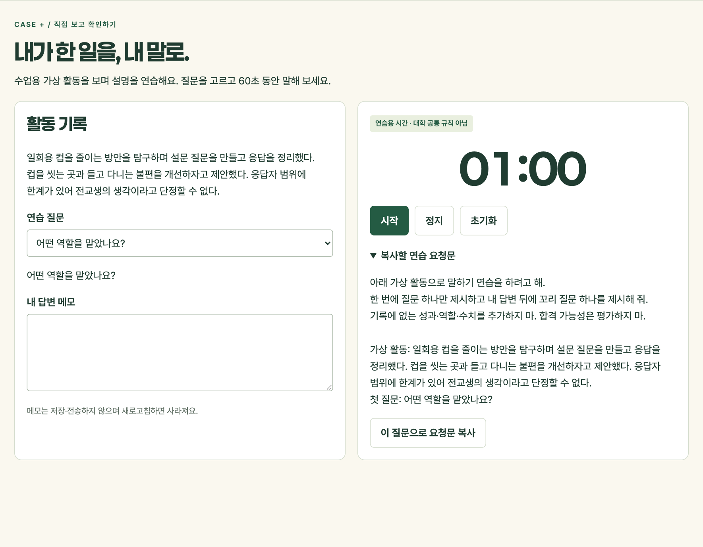

질문을 고르고 시작을 눌러 보세요. 멈춘 뒤 이어서 말할 수도 있고 초기화해 다시 60초부터 연습할 수도 있어요. 60초는 이 연습장의 설정이며 대학 공통 면접 시간이 아니에요.

‘이 질문으로 요청문 복사’를 누르기 전에 복사할 글을 읽어 보세요. 가상 활동과 선택한 질문이 들어가고, 개인 메모는 포함되지 않아요. 복사 버튼이 다른 AI 서비스의 음성 기능을 자동 실행하는 것은 아닙니다.

잘 말하려면 내가 한 일을 구체적으로 알아야 해요. 맡은 역할, 자료를 다룬 방법, 결과의 한계를 설명해 보세요. 없던 성과를 더하기보다 실제 활동을 더 정확히 이해하는 것이 먼저입니다.

## 막혔을 때 · 증상을 설명하는 연습

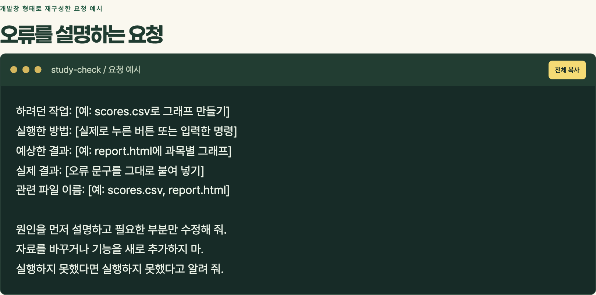

“안 돼요”만 적으면 어느 단계에서 막혔는지 알기 어려워요. 시험지에 이름만 쓰고 제출한 느낌이랄까요. 아래 틀에 실제로 확인한 내용을 적어 보세요.

```text
하려던 작업: [예: scores.csv로 그래프 만들기]
실행한 방법: [실제로 누른 버튼 또는 입력한 명령]
예상한 결과: [예: report.html에 과목별 그래프]
실제 결과: [오류 문구를 그대로 붙여 넣기]
관련 파일 이름: [예: scores.csv, report.html]

원인을 먼저 설명하고 필요한 부분만 수정해 줘.
자료를 바꾸거나 기능을 새로 추가하지 마.
실행하지 못했다면 실행하지 못했다고 알려 줘.
```

오류 문구에 계정 정보나 개인 경로가 섞였다면 필요한 부분만 남기세요. 수정한 뒤에는 처음에 정한 확인 기준으로 돌아가요. 오류 하나를 고치면서 다른 기능이 달라지지는 않았는지도 확인합니다.

## 수업 뒤 선택 가이드 · 시작하기

여기부터는 혼자 따라 해 보는 부분이에요. 모두 할 필요는 없어요. 학과 비교, 성적 분석, 파일 정리 중 지금 필요한 작업 하나를 고르세요. 면접 연습 앱은 추가 선택지예요.

### 준비할 것

- AI 코딩 도구를 사용할 수 있는 환경
- 가상 자료와 결과를 모을 작업 폴더
- 결과 파일을 열 브라우저나 스프레드시트 프로그램

도구를 쓸 수 있는지, 계정에 어떤 조건이 있는지는 학교와 해당 서비스의 안내를 확인하세요. 제품마다 폴더를 열거나 파일을 내려받는 방식이 달라요. 이 가이드는 특정 버튼 위치보다 **자료 준비→요청→실행→확인** 순서를 다뤄요.

폴더에서 작업할 수 있는 도구라면 연습용 폴더만 열어 주세요. 파일 변경이나 실행 확인 메시지가 나오면 대상과 내용을 읽고 진행하세요. 채팅에서 코드만 받은 상태라면 아직 실행된 게 아니에요. 파일을 저장하고 실행하는 방법까지 확인해야 합니다.

막히면: 여러 기능을 한꺼번에 더하지 말고 지금 자료와 기대한 결과, 실제 오류를 함께 적어 도움을 구하세요.


## 따라하기 A · 학과 비교표

### 1. 관심 활동과 자료 준비

재미있었던 활동을 두세 문장으로 적으세요. 이름·학교·연락처 같은 정보는 필요 없어요. [커리어넷](https://www.career.go.kr/cloud/m/main/home)에서 학과를 탐색한 뒤 후보 학과의 공식 홈페이지에서 교육과정과 교과목 설명을 확인하세요.

출처 주소와 확인한 날짜도 남겨 두세요. 입시 조건은 [대입정보포털 어디가](https://www.adiga.kr/man/inf/mainView.do)와 대학의 **지원 연도 공식 모집요강**에서 따로 확인하고 선생님과 상담하세요.

### 2. 표를 만드는 코드 요청

```text
목표: 관심 활동과 후보 학과의 공식 교육과정을 비교하고 싶어.
아래 자료를 읽어 비교표를 만드는 코드를 작성하고 실행해 줘.
결과는 major-comparison.html과 CSV로 저장해 줘.

열: 학과명, 자료에 나온 수업, 내 관심과 연결되는 점,
더 알아볼 질문, 출처 주소, 자료 확인 날짜.
공식 자료에 있는 사실과 관심에 따른 해석은 구분해 줘.
자료에 없는 정보는 확인 필요로 표시해 줘.
적합도 점수나 합격 가능성은 계산하지 마.
원자료를 바꾸지 말고, 실행하지 못하면 그 사실을 알려 줘.

내 관심 활동: [내가 적은 내용]
후보 학과 자료: [학과명·교육과정 발췌·출처·확인 날짜]
```

### 3. 결과 확인

표에서 수업명을 골라 원문과 대조해 보세요. 링크는 실제 자료로 연결되나요? 자료에 없는 진로나 수업이 들어가지는 않았나요? 관심과 연결된다는 해석에 동의하는지도 살펴보세요.

✓ 완료 기준: 출처를 확인한 비교표와 더 알아볼 질문이 남았어요. 학과를 하나로 확정할 필요는 없어요.

## 따라하기 B · 가상 성적 그래프

### 1. CSV 준비

작업 폴더 이름을 `study-check`로 정하고 아래 내용을 `scores.csv`로 저장하세요. [연습용 CSV](examples/scores.csv)를 내려받아도 돼요. CSV는 쉼표로 값을 구분한 표예요. 문자 인코딩은 UTF-8을 사용하세요.

```csv
과목,시험1,시험2,시험3
수학,72,78,81
영어,86,82,84
```

이 자료는 가상 원점수이고 만점은 100점이에요. 원점수와 등급을 한 표에서 같은 의미로 섞지 마세요.

### 2. 요청문 입력

```text
study-check 폴더의 scores.csv를 읽어 과목별 원점수 변화를
그리는 코드를 작성하고 실행해 줘.
결과는 report.html 하나로 저장해 줘.

조건:
- 가로축은 시험1, 시험2, 시험3 순서, 세로축은 0~100점.
- 과목마다 색과 선 모양을 구분하고 과목명을 표시해 줘.
- 그래프 아래에 원자료 표를 넣어 줘.
- 처음과 마지막 시험의 차이를 계산해 표시해 줘.
- 빈칸은 자료 없음으로 표시하고 0점으로 바꾸지 마.
  처음이나 마지막 값이 비어 있으면 차이는 계산 불가로 표시해 줘.
- 숫자가 아니거나 0~100 범위를 벗어나면 오류를 알려 줘.
- 외부 라이브러리·네트워크 요청 없이 브라우저에서 열리게 해 줘.
- 원본 CSV를 바꾸거나 자료를 외부로 전송하지 마.
- 점수만으로 실력이나 합격 가능성을 단정하지 마.

실행한 검사와 아직 확인하지 못한 점을 알려 줘.
```

여기서 “자료를 외부로 전송하지 마”는 만드는 코드의 동작 조건이에요. AI 서비스에 입력한 요청문이나 파일은 별도로 처리될 수 있으니 실제 자료 대신 가상 자료를 쓰세요.

### 3. 실행 결과 확인

`report.html`을 브라우저로 열어 숫자를 대조하세요. 수학의 차이는 +9점, 영어는 −2점이어야 해요. 축과 시험 순서도 확인하세요.

복사본에서 영어 시험2 값을 비운 뒤 다시 실행해 보세요. 0점으로 표시되면 오류예요. 처음이나 마지막 값을 비웠을 때 차이를 계산 불가로 표시하는지도 확인해 보세요.

막히면: [준비된 예시 보고서](examples/report.html)로 원자료와 먼저 대조해 보세요. 이 파일은 강사가 준비한 예시라 여러분의 요청으로 생성된 결과를 대신 검증해 주지는 않아요.

### 4. 공부 계획 연결

그래프만 보고 계획을 확정하지 말고 오답을 직접 살펴보세요. 반복된 실수 하나와 다음에 해 볼 공부 하나, 다시 확인할 날짜를 적어 보세요.

✓ 완료 기준: 숫자·축·빈칸 처리를 확인했고 오답을 근거로 해 볼 공부를 하나 정했어요.

## 따라하기 C · 파일 이름 정리

### 1. 연습용 파일만 준비

빈 연습 폴더 `file-practice`를 만들고 복사본 파일 세 개만 넣어 보세요. 원래 자료 폴더에서 바로 실행하지 마세요. 파일마다 확인한 날짜·과목·주제를 표로 정리합니다.

### 2. 미리보기부터 요청

```text
file-practice 폴더의 파일 이름을 정리하려고 해.
우선 파일을 바꾸지 않는 미리보기 코드를 작성하고 실행해 줘.

아래 대응표의 기존 이름과 새 이름을 그대로 사용해 줘.
날짜나 과목을 추측하지 마.
기존 이름, 새 이름, 파일 존재 여부, 이름 중복 여부를 표로 저장해 줘.
확장자는 유지하고 하위 폴더는 건드리지 마.
목록에 없는 파일을 수정하거나 삭제하지 마.
이 단계에서는 실제 이름 변경을 실행하지 마.

대응표: [내가 확인한 기존 이름 → 새 이름]
```

파일 수와 이름을 하나씩 확인하세요. 새 이름이 서로 겹치거나 같은 이름의 파일이 이미 있으면 대응표부터 고쳐야 해요.

### 3. 확인한 복사본에만 적용

```text
미리보기 표를 직접 확인했어.
확인한 대응표의 파일만 이름을 바꾸는 기능을 추가해 줘.
기본 실행은 미리보기이고, 별도 적용 옵션을 넣었을 때만 변경해 줘.
파일이 없거나 새 이름이 겹치면 변경 전에 멈추고 이유를 알려 줘.
덮어쓰기와 삭제는 하지 마.
되돌릴 때 참고할 이전 이름·새 이름 기록을 남겨 줘.
먼저 연습용 복사본에서 실행하는 방법을 알려 줘.
```

✓ 완료 기준: 원본이 남아 있고 연습 파일의 수와 내용은 같으며 확인한 이름만 바뀌었어요.

## 선택 확장 · 면접 연습 앱

활동 설명을 자주 연습하고 싶을 때는 앱 화면을 만들 수도 있어요. 첫 버전은 가상 활동 하나, 질문 다섯 개, 메모, 60초 타이머, 요청문 복사로 좁혀 봅니다.

### 1. 작은 연습장 만들기

```text
가상 활동을 보며 말하기 연습을 하는 웹페이지를 만들어 줘.
파일은 index.html 하나로, 외부 연결 없이 브라우저에서 열리게 해 줘.
활동 기록과 질문을 나란히 보여 주고, 답변 메모를 쓸 수 있게 해 줘.
60초 시작·정지·초기화 타이머와 요청문 복사 버튼을 넣어 줘.
복사할 요청문에는 활동 기록과 선택한 질문만 넣고 내용을 미리 보여 줘.
메모는 저장하거나 전송하지 않고 새로고침하면 지워지게 해 줘.
로그인, API, 자동 음성 연결은 넣지 마.

가상 활동:
일회용 컵을 줄이는 방안을 탐구하며 설문 질문을 만들고 응답을 정리했다.
컵을 씻는 곳과 들고 다니는 불편을 개선하자고 제안했다.
응답자 범위에 한계가 있어 전교생의 생각이라고 단정할 수 없다.

질문:
1. 어떤 역할을 맡았나요?
2. 설문 질문을 만들 때 무엇을 고민했나요?
3. 응답에서 어떤 불편을 살펴봤나요?
4. 결과를 해석할 때 어떤 한계가 있었나요?
5. 다시 한다면 무엇을 바꾸고 싶나요?
```

질문을 고르면 내용이 맞게 바뀌는지, 타이머가 멈추고 60초로 돌아오는지, 복사한 글에 선택한 질문이 들어가는지 확인하세요. 새로고침하면 메모가 사라지는 것은 이 예제에서 정한 동작이에요.

### 2. 별도 서비스에서 말하기 연습

복사한 내용을 읽고 필요한 부분만 별도 AI 서비스에 보내세요. 음성 기능을 쓸 수 있으면 말로, 없으면 글로 연습할 수 있어요. 앱의 복사 버튼이 음성 기능을 자동 실행하지는 않습니다.

```text
아래 가상 활동으로 말하기 연습을 하려고 해.
실제 대학 기출이라고 표현하지 말고 연습 질문만 사용해 줘.
한 번에 질문 하나만 제시하고 내 답변 뒤에 꼬리 질문 하나를 제시해 줘.
기록에 없는 성과·역할·수치를 추가하지 마.
피드백은 실제 기록과 비교해서 빠진 설명을 짚어 줘.
합격 가능성은 평가하지 마.

가상 활동: [위 기록]
첫 질문: 어떤 역할을 맡았나요?
```

음성 인식 결과가 내가 말한 내용과 같은지 먼저 확인하세요. 피드백에도 틀린 내용이 있을 수 있어요. 실제로 한 일을 보태 다시 답하면 됩니다. 60초는 연습용 설정이고 대학 공통 규칙이 아니에요.

✓ 완료 기준: 없던 성과를 더하지 않고 맡은 일·방법·한계 중 하나를 더 구체적으로 설명했어요.

## 막혔을 때 돌아올 곳

| 증상 | 확인하고 시도할 일 |
|---|---|
| 코드만 보이고 결과가 없다 | 저장할 파일과 실행 방법을 확인해요. 실행 완료 여부도 구분해요 |
| 한글이 깨진다 | CSV를 UTF-8로 저장했는지 확인해요 |
| 값이 예상과 다르다 | 원자료의 값·열 이름·자료 종류부터 대조해요 |
| 파일을 찾지 못한다 | 실제 파일명·확장자·작업 폴더를 확인해요 |
| 웹페이지가 예전 모습이다 | 저장한 파일과 지금 연 파일이 같은지 확인한 뒤 새로고침해요 |
| 복사 버튼이 안 된다 | 표시된 요청문을 직접 선택해 복사해요 |
| 기능을 고치니 다른 것이 깨진다 | 잘 되던 버전으로 돌아가 수정 범위를 하나로 좁혀요 |

도구의 메뉴와 이용 조건은 달라질 수 있어요. 사용 중인 제품의 공식 안내를 확인하세요. [Codex 시작 안내](https://developers.openai.com/codex/quickstart), [권한 안내](https://developers.openai.com/codex/permissions), [ChatGPT 음성 기능 안내](https://help.openai.com/en/articles/20001274-chatgpt-voice)를 참고할 수 있습니다.

## 마지막으로 남길 한 장

지금 필요한 작업 하나를 골라 아래 빈칸을 채워 보세요. 멋진 앱 이름을 정하지 않아도 됩니다.

| 질문 | 내 기록 |
|---|---|
| 무엇을 왜 하고 싶은가? | |
| 어떤 자료가 필요한가? | |
| 어떤 결과를 만들고 싶은가? | |
| 무엇과 대조해 확인할 것인가? | |
| 더 알아야 할 내용은 무엇인가? | |
| 확인한 뒤 무엇을 바꿔 볼 것인가? | |

**아는 만큼 말할 수 있고, 말하는 만큼 만들 수 있습니다.**
